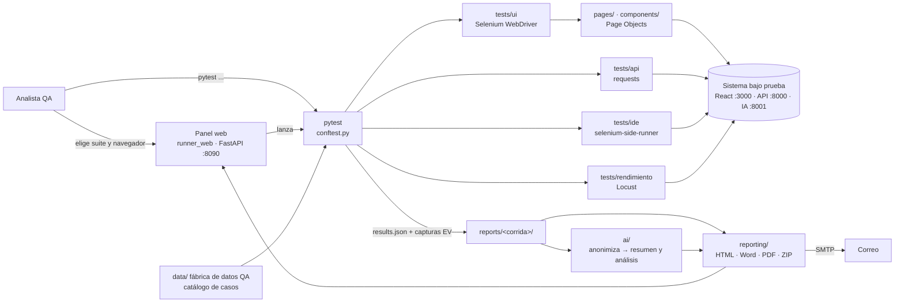

# Automatización de pruebas · Fetal Medical Bolivia

Solución de automatización del sistema web de historia clínica gineco-obstétrica **Fetal Medical Bolivia**
(React + Django REST + microservicio de IA). Prueba el sistema con sus **cinco roles** (administrador, médico,
enfermería, laboratorio y recepción) por la interfaz y por la API, mide su rendimiento, genera reportes con
evidencias y los envía por correo.

> Este proyecto **no es** el sistema bajo prueba: es el que lo prueba. El sistema bajo prueba es [Proyector-historial](https://github.com/Mirkof69/Proyector-historial) (`backend/`, `frontend/`, `servicio-ia/`).

| Qué | Con qué |
|---|---|
| Interfaz (framework principal) | Selenium WebDriver 4.52 + pytest 9.2, patrón Page Object Model |
| API | pytest + requests |
| Selenium IDE | 35 proyectos `.side` (login de los 5 roles, menú, URL prohibidas, buscadores y filtros de 17 listados, registro, calculadora, reportes) con selenium-side-runner 4.0.13 |
| Rendimiento | Locust 2.47 |
| Ejecución | Panel web propio (FastAPI) o línea de comandos |
| Reportes | HTML, Word, PDF y ZIP con evidencias `EV-<TC>-<paso>-<fecha>` |
| IA (valor agregado) | Ollama local o Claude; solo sugiere, nunca decide un PASS/FAIL |

## Arquitectura



Flujo de una corrida: **selección de suite → preparación de datos sintéticos QA → ejecución → aserciones →
capturas de evidencia → `results.json` → reportes → (IA) → correo → limpieza de los datos QA**.

## Estructura

```
automatizacion/
├── config/config.yaml        configuración no secreta (URL, navegador, esperas)
├── .env.example              variables con valores ficticios (copiar como .env)
├── conftest.py               fixtures (navegador por rol, API por rol, datos QA), resultados y evidencias
├── pytest.ini                marcadores (smoke, regression, roles, pacientes, ...)
├── pages/                    Page Objects: base, login, pacientes, formularios clínicos, pantalla genérica
├── components/               componentes reutilizables (menú lateral)
├── tests/
│   ├── ui/                   Selenium WebDriver: autenticación, pacientes, flujo clínico, roles, barrido
│   ├── api/                  permisos por rol, pacientes, historia clínica, ecografía e IA, citas, robustez
│   ├── ide/                  reproduce las grabaciones de Selenium IDE
│   └── rendimiento/          Locust: carga, estrés, pico y resistencia
├── selenium_ide/             35 proyectos .side (uno por caso) y FetalMedical_SeleniumIDE.side con una suite por módulo
├── locust/locustfile.py      usuarios virtuales por rol (solo lecturas)
├── data/                     catálogo de casos, fábrica de datos Faker, defectos, imágenes de ecografía de prueba
├── utils/                    configuración, driver, cliente de la API, TOTP, evidencias
├── reporting/                modelo del reporte, HTML, Word, PDF, ZIP y correo
├── ai/                       anonimizador, proveedores (Ollama, Claude) y tareas
├── runner_web/               panel web de ejecución
├── tools/                    inventario del sistema, explorador, sonda de DOM, exportadores
├── docs/                     inventario, casos de prueba, trazabilidad, defectos, decisiones, checklist
└── reports/                  una carpeta por corrida (no se versiona)
```

## Requisitos

- Windows 10/11, Python 3.12, Google Chrome (Edge y Firefox opcionales). Selenium Manager descarga el driver.
- Node.js 18+ solo para las grabaciones de Selenium IDE.
- Microsoft Word solo para el PDF del reporte (sin Word se generan HTML y Word).
- El sistema en marcha: `..\INICIAR.bat` (interfaz en `http://localhost:3000`, API en `http://localhost:8000`).

## Instalación

```bat
cd automatizacion
python -m venv .venv
.venv\Scripts\python -m pip install -r requirements.txt
copy .env.example .env
```

Complete `.env`: la clave de las cuentas de prueba, la clave TOTP de las cuentas con doble factor, el usuario y la
clave del panel y, si quiere correo, la contraseña de aplicación de Gmail. **`.env` no se sube al repositorio.**

## Ejecución

### Con el panel web

```bat
EJECUTAR_PANEL.bat
```

Abre el **Centro de Pruebas QA** en `http://127.0.0.1:8090` (usuario y clave: `RUNNER_USER` / `RUNNER_PASSWORD`;
`RUNNER_SECRET` firma la sesión). Tiene cuatro secciones:

| Sección | Qué hace |
|---|---|
| Panel | Salud de la última corrida (PASS ÷ ejecutadas), tendencia por corrida, resultados por módulo, cobertura, defectos y estado del sistema bajo prueba |
| Ejecutar pruebas | Un botón por suite (humo, extremo a extremo, por herramienta y por módulo) y uno para la ejecución masiva (las 573 pruebas). Avance en vivo: porcentaje, PASS/FAIL, caso en curso, pantalla del navegador y registro de pytest; se puede cancelar. Al terminar: salud, resultado por tipo y botones **Ver videos**, **Enviar por correo** y los reportes |
| Corridas y grabaciones | Cada corrida con sus reportes HTML/PDF/Word/ZIP, resultados **por tipo de prueba** (humo, regresión, E2E, API, interfaz, Selenium IDE, rendimiento) y por módulo, el video de cada prueba de interfaz, sus evidencias EV y errores; botones para enviar por correo, ver los videos, regenerar reportes y repetir solo los fallidos |
| Métricas | Cobertura de automatización y de requisitos, casos por herramienta y técnica, defectos por severidad y rendimiento con Locust |

**Grabaciones.** Con «Grabar video» activo (`QA_GRABAR=1`), `utils/grabacion.py` toma la pantalla de cada navegador
que usa la prueba dos veces por segundo por el protocolo DevTools (sin pasar por la cola de WebDriver) y ffmpeg arma
`reports/<run_id>/videos/VID-<TC>-….mp4`. También graba las reproducciones de Selenium IDE. Sin ffmpeg, la prueba
corre igual y no deja video.

**Correo.** «Enviar por correo» abre una ventana: destinatario principal (`MAIL_TO` de `.env`), otros correos
(por ejemplo, el Gmail de un docente), asunto, mensaje y adjuntos a elegir (reporte PDF, Word o HTML, resultados en
CSV o JSON, ZIP con evidencias y el Capítulo 6), con el límite de 25 MB de Gmail. El cuerpo lleva la salud y los
resultados por tipo de prueba y por módulo. El envío automático al terminar una corrida también acepta otros correos.

**Extremo a extremo.** `tests/e2e/test_atencion_completa_e2e.py` (TC-173) recorre una atención completa por la
interfaz con dos roles: registro de la paciente, embarazo, control prenatal, ecografía con IA e historia clínica,
comprobando cada paso en la API.

**Editor.** `pyrefly.toml` le indica al analizador de Python del editor que este proyecto usa su propio `.venv` y
sus imports desde esta carpeta; sin él marcaba «Cannot find module» en todos los módulos.

**En internet.** `PUBLICAR_PANEL.bat` abre un túnel de Cloudflare propio del panel (no toca el del sistema) y copia
la dirección al portapapeles.

### Por línea de comandos

```bat
.venv\Scripts\python -m pytest -m smoke                       :: humo (≈ 2 min)
.venv\Scripts\python -m pytest tests\api                      :: API completa
.venv\Scripts\python -m pytest tests\ui -m "not regression"   :: interfaz sin el barrido de pantallas
.venv\Scripts\python -m pytest -m roles                       :: roles y permisos
.venv\Scripts\python -m pytest tests\ide                      :: los 35 casos de Selenium IDE
.venv\Scripts\python -m pytest -m busqueda                    :: buscadores y filtros con WebDriver (17 listados)
.venv\Scripts\python -m pytest -k tc171 --visible             :: localizadores por ID, Name, XPath y CSS, a la vista
.venv\Scripts\python tools\ver_side.py selenium_ide\TC-139_buscar_embarazos.side   :: un caso de Selenium IDE
.venv\Scripts\python -m pytest tests\rendimiento              :: Locust, 40 usuarios (TC-112)
.venv\Scripts\python -m pytest                                :: todo
.venv\Scripts\python -m pytest tests\ui\test_pacientes_ui.py -k tc021 --visible --navegador edge
```

Opciones propias: `--navegador chrome|edge|firefox`, `--visible` (muestra el navegador), `--suite nombre`.
Varias órdenes pueden acumular en un mismo reporte si comparten la variable `QA_RUN_ID`.

Las pruebas de estrés, pico y resistencia (TC-113 a TC-115) pueden saturar el equipo: quedan `NOT RUN` salvo que
`.env` tenga `AUTORIZAR_ESTRES=1`.

### Reportes, correo e IA

```bat
.venv\Scripts\python -m reporting.generar                 :: HTML, Word, PDF y ZIP de la última corrida
.venv\Scripts\python -m reporting.generar --run 20261114-105512 --correo
.venv\Scripts\python -m ai.tareas estado                  :: ¿hay proveedor de IA disponible?
.venv\Scripts\python -m ai.tareas resumen                 :: resumen ejecutivo de la última corrida
.venv\Scripts\python -m ai.tareas fallos                  :: análisis de cada fallo
.venv\Scripts\python -m ai.tareas gherkin "RF-09 Registrar un control prenatal con alerta de presión"
.venv\Scripts\python tools\exportar_casos.py              :: Excel de casos, trazabilidad y coberturas
```

Resultados en `reports/<corrida>/`: `results.json`, `reporte.html`, `reporte.docx`, `reporte.pdf`,
`evidencias/EV-*.png`, `locust/` y `fetal_medical_<corrida>.zip`.

## Estados y clasificación

| Estado | Significado |
|---|---|
| PASS | La aserción se cumplió |
| FAIL | La aserción no se cumplió (clasificación inicial: sistema, script, datos o ambiente) |
| BLOCKED | No se pudo ejecutar por una condición externa (por ejemplo, no se pudo iniciar sesión) |
| NOT RUN | Definida pero no ejecutada (por ejemplo, estrés sin autorización) |

## Datos y seguridad

- **Solo datos sintéticos**: nombres con prefijo `QA`, cédulas que empiezan con `99`. Al terminar, la corrida da de
  baja a las pacientes QA y cancela las citas QA que creó.
- Las credenciales viven en `.env`; `config/config.yaml`, las grabaciones `.side` y los reportes no las contienen.
- La IA recibe únicamente texto anonimizado (`ai/anonimizador.py`) y cada uso queda en `ai/registro_uso_ia.jsonl`.
- El caso TC-119 (doble factor) usa una cuenta temporal propia: ninguna prueba cambia la clave de una cuenta real.

## Documentación

- `docs/inventario/`: pantallas, formularios, endpoints y matriz de roles generados del código del sistema.
- `docs/casos_prueba.xlsx` y `docs/matriz_trazabilidad.md`: casos, requisito → caso → script → defecto → resultado.
- `docs/defectos/`: un informe por defecto (`BUG-XXX.md`) y `registro_defectos.csv`.
- `docs/decisiones.md`: decisiones técnicas y sus motivos.
- `docs/checklist_entrega.md`: lista de verificación de la guía del Capítulo 6.
- `capitulo6/`: fuente, figuras y generador del Capítulo 6; el Word y el PDF están en `capitulo6/entregables/`.


## Si una corrida se interrumpe

Una corrida cancelada o cortada no llega a limpiar sus datos. El panel lo hace al cancelar; por consola:

```bat
.venv\Scripts\python tools\limpiar_qa.py --solo-contar   :: cuántas pacientes y citas QA quedaron activas
.venv\Scripts\python tools\limpiar_qa.py                 :: las da de baja y cancela las citas
```
